  <!-- Responsive Capsule Banner -->
  <picture>
    <source media="(prefers-color-scheme: dark)" srcset="https://capsule-render.vercel.app/api?type=waving&color=7C3AED&height=200&section=header&text=Rachel%20Huthwaite&fontSize=50&fontColor=ffffff&animation=fadeIn&desc=Software%20Engineer%20%7C%20Design-Minded%20Developer&descSize=16&descAlignY=70">
    <source media="(prefers-color-scheme: light)" srcset="https://capsule-render.vercel.app/api?type=waving&color=4F46E5&height=200&section=header&text=Rachel%20Huthwaite&fontSize=50&fontColor=ffffff&animation=fadeIn&desc=Software%20Engineer%20%7C%20Design-Minded%20Developer&descSize=16&descAlignY=70">
    
  </picture>

    

  <!-- Animated Typing Title -->
  

  

    <i>Passionate developer bridging backend architecture, Linux systems, and intuitive user experiences.</i>
  

   

  <!-- Social Badges -->
  
  

 

---

### 🎨 About Me

  

I am a **Software Engineering Student at WeThinkCode_** focused on building full-stack web applications and cross-platform mobile experiences. I started with Python before moving into Java for backend development, and I work across the frontend with HTML, CSS, and JavaScript. On mobile, I build with Flutter/Dart and React Native (Expo), backed by Firebase and Supabase, and I've integrated third-party APIs including Google Auth and Calendar into team projects.

* 🎓 **Education:** Software Engineering at WeThinkCode_
* 🛠️ **Current Focus:** Mobile Development and collaborating. I recently built **Fundazaka**, a personal project in React Native, purely for my own growth, while at WeThinkCode_ we are learning Flutter (Dart). Working across different frameworks has shown me that once you understand the logic, the skill is transferable.
* 💡 **Design Approach:** Code should be as clean, structured, and intentional as the design system backing it.

---

### 🧩 Core Competencies

* **Software Engineering Principles:** OOP, Data Structures & Algorithms, Clean Code Architecture.
* **Full-Stack Development:** RESTful web APIs, relational databases, persistence layers, HTML/CSS/JavaScript.
* **Mobile Development:** Flutter, Dart, React Native, Expo, Firebase, cross-platform app design, translating Figma mockups into working screens.
* **Authentication & Backend-as-a-Service:** Supabase email/password auth, secure environment configuration, session handling, Firebase.
* **App Architecture & State:** File-based routing with Expo Router, local persistence with AsyncStorage, reusable shared components, onboarding and launch flows.
* **Collaboration:** Shared environments across two developers, sprint-based delivery, Git workflow (issues, branches, pull requests).
* **Third-Party & Cloud Integrations:** Firebase, Supabase, Google Auth & Calendar API, OpenAI API.
* **DevOps & Pipeline Automation:** Docker containerization, CI/CD pipelines, Bash scripting automation.
* **Testing & Quality:** Unit testing with JUnit and automated test scripts.
####

  

---

### 🎓 Learning and Community Resources

I document my journey through learning and create hands-on material to help other developers learn too.

| Repository | Focus Area | Type | Description |
| :--- | :--- | :--- | :--- |
| 🔴 **[Red Hat Linux RH024](https://github.com/Rachel-Huthwaite/redhat-linux-RH024)** | Linux SysAdmin & RH024 | Community Resource | RH024 course labs, system configuration notes, and CLI practice. |
| 📚 **[Dartpedia](https://github.com/Rachel-Huthwaite/dartpedia)** | Introduction to Dart | Learning Tutorial | A dedicated Dart learning project exploring language features, core utilities, and fundamental logic. Following the official Dart Documentation. |
| 🐤 **[Birdle](https://github.com/Rachel-Huthwaite/birdle-flutter)** | Introduction to Flutter | Learning Tutorial | A Wordle-inspired guessing game built in Flutter following the official Flutter documentation track. Focuses on interactive UIs, dynamic keyboards, and state management. |

  

---

### 💻 Tech Stack & Tools

**Languages & Mobile**
 

---

  

**Backend, DevOps & Databases**
 

---

  

**Tools & Environment**
 

  

---

### 🚀 Highlighted Projects

<table width="100%">
  <tr>
    <td width="50%" valign="top">
      <h3 align="center">💸 Fundazaka</h3>
      

      
A mobile budgeting app for people with irregular income, built with a friend for the FNB App of the Year Hackathon. Built with React Native, Expo Router, and Supabase auth, with local persistence, a guided onboarding tour, and multi-language support.

      

        <a href="https://github.com/Rachel-Huthwaite/fundazaka"><code>View Repository</code></a>
      

    </td>
    <td width="50%" valign="top">
      <h3 align="center">🎓 Petty University</h3>
      
Full-stack project with Firebase integration, focusing on modern system structures, domain modeling, and data persistence. <i>(In Progress / Upgrading)</i>

      

        <a href="https://github.com/Rachel-Huthwaite/petty_university"><code>View Repository</code></a>
      

    </td>
  </tr>
  <tr>
    <td width="50%" valign="top">
      <h3 align="center">⚡ Loadshedding Tracker</h3>
      
A dynamic utility app designed to track load shedding schedules, state changes, and user notifications. <i>(In Progress / Upgrading)</i>

      

        <a href="https://github.com/Rachel-Huthwaite/loadshedding-tracker"><code>View Repository</code></a>
      

    </td>
    <td width="50%" valign="top">
      <h3 align="center">🗂️ Sortly</h3>
      
A modular Python file-organisation tool that tidies cluttered folders by file type. Starting as a CLI, with a GUI and an AI-powered content-based organiser planned. <i>(In Progress)</i>

      

        <a href="https://github.com/Rachel-Huthwaite/sortly"><code>View Repository</code></a>
      

    </td>
  </tr>
</table>

 

---

### 📊 GitHub Activity & Stats

  <!-- Top Languages Card (Updated Endpoint) -->
  

    

  <!-- GitHub Streak Stats -->
  

